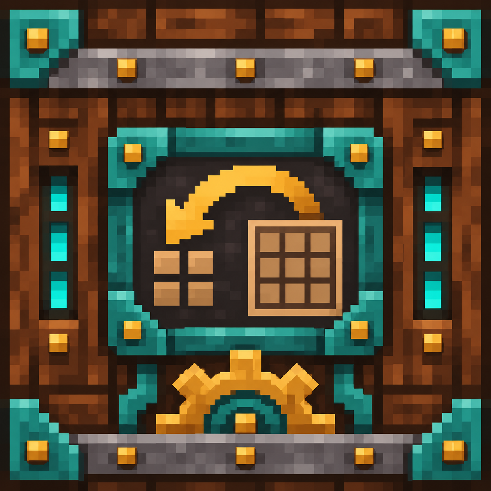
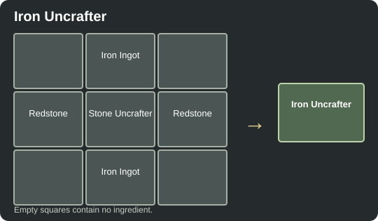
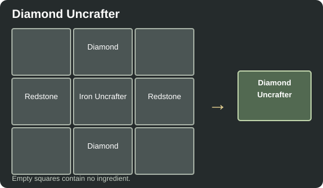
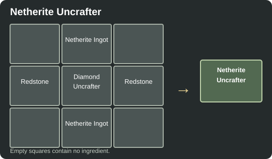
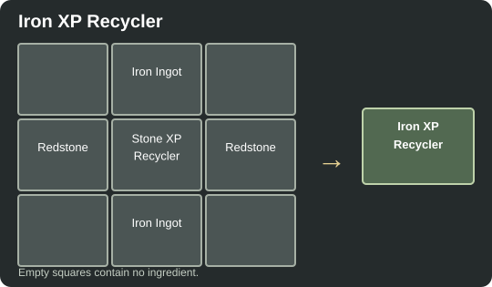
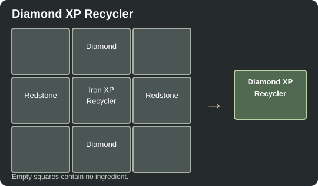
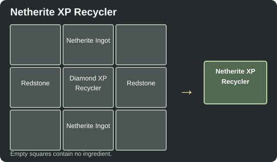
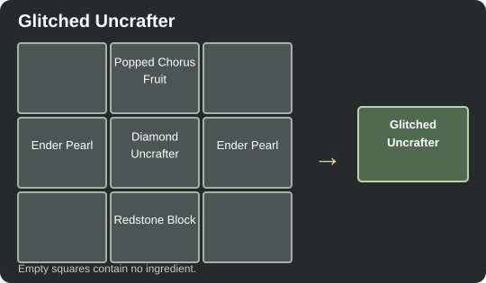
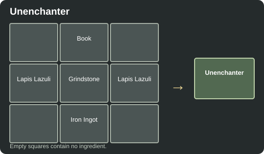

# Uncrafter Plus workstations

Included with Inventory Manager 1.1.0 for Minecraft Java 26.3. [Installation and upgrade instructions](../README.md#install)

The workstations use original pixel textures with timber, metal, teal and gold details. Each family has its own symbol, and the material accents identify its tier. The block item uses the same model as the placed workstation.

## First batch

Craft a **Stone Uncrafter** at a crafting table. Fill the top and bottom rows with cobblestone. In the middle row, place redstone dust, a crafting table and redstone dust. Place the station on top of a chest, then right-click it with **six oak slabs**. The chest receives **three oak planks**. Five slabs stay in your hand until you have a complete batch.

In Creative, search for “Uncrafter”. With commands enabled, use `/give @s uncrafter_plus:stone_uncrafter`.

## Stations

| Station | How to use it |
| --- | --- |
| Stone, Iron, Diamond and Netherite Uncrafters | Use a crafted item on the station to dismantle one recipe batch. Tier gates depend on the recovered materials. Iron unlocks iron and gold recipes, diamond unlocks diamond and emerald recipes, and netherite unlocks netherite recipes. |
| Stone, Iron, Diamond and Netherite XP Recyclers | Use a plain item to convert it to 1, 2, 3 or 4 XP points respectively. Collect the XP orbs above the machine. Recyclers accept worn gear and protect stacks with custom names, enchantments or stored contents. |
| Glitched Uncrafter | Pay one experience level per batch for a 25% chance to double all recovered materials. An ordinary roll returns one batch. Use a Bottle o’ Enchanting to bank a charge for manual or hopper use. The station spends stored charges first and holds up to 64. |
| Unenchanter | Use enchanted equipment to recover the gear and one enchanted book per enchantment. Books retain their levels, including curses. The returned equipment retains its name, wear and other components. |
| Recipe Storage | Use a sample item to preview batch size and materials. Repeated uses cycle through alternate recipes. Place the storage block against an uncrafter to apply the selected recipe for that product. The sample stays in your hand. |

For the Stone XP Recycler, use the Stone Uncrafter pattern with a furnace in the center. To upgrade either machine, place the previous tier in the center with redstone dust on its left and right. Put an iron ingot, diamond or netherite ingot above and below for the corresponding upgrade. The crafting recipe book includes all eleven workstations.

## Crafting recipes

Craft each workstation in a crafting table. Each image shows the ingredients in their exact grid positions.

### Uncrafters

#### Stone Uncrafter

#### Iron Uncrafter

#### Diamond Uncrafter

#### Netherite Uncrafter

### XP recyclers

#### Stone XP Recycler

#### Iron XP Recycler

#### Diamond XP Recycler

#### Netherite XP Recycler

### Other workstations

#### Glitched Uncrafter

#### Unenchanter

#### Recipe Storage

### Hoppers and collection

Point a hopper into the top or side of a processing station. Hopper inputs accumulate in a single slot until enough items exist for one batch. At 20 ticks per second, the four tiers check buffered input every 2, 1, 0.5 and 0.25 seconds. A Glitched Uncrafter needs stored charges for hopper processing. Empty-hand use retrieves a stalled input. Breaking a station releases its buffered items.

Place a chest, barrel or accepting hopper directly beneath the station to receive its products. Overflow drops above the station. Without an output container, collect the drops there. XP always appears as orbs.

### Which recipes work?

The mod indexes the world’s active ordinary shaped and shapeless crafting recipes, including standard recipes supplied by mods and data packs. A data-pack reload refreshes the index. It reads the actual output count and ingredient slots from each recipe. The Java item stack does not record the original crafting grid, so a tag-based ingredient gets a consistent representative, with oak preferred for generic wood.

Worn equipment yields fewer materials, rounded down per ingredient type. Customized stacks must match the recipe’s product components, apart from wear. Recipes with reusable containers, unsupported ingredient states, or a one-for-one self-refund are skipped. Cooking, smithing and special dynamic recipes are outside this version’s reverse-crafting support.

## Bedrock research and Java design choices

Dalibu Studios’ original description lists 600 reverse recipes, an unenchanter, a recycler and a Glitched Uncrafter. The later 2.1 Marketplace listing adds Recipe Storage, hopper input and chest output. This adaptation uses Java’s live recipe registry for discovery and uses Recipe Storage to select among alternatives. Tier gates, machine crafting costs, XP values and glitch odds are specific to this Java version. [Dalibu Studios’ overview](https://www.dalibustudios.com/projects/uncrafter-add-on) · [Bedrock Marketplace listing](https://www.minecraft.net/en-us/marketplace/pdp?id=943a10e3-1001-4cae-a18b-5109dee023bd) · [2.1 listing and update notes](https://bedrockbuddy.com/marketplace/uncrafter-2-1-add-on)
